# Gimli style study

**Chosen on 30 October 2026: A, Faceted.**

One dwarf, built in Blender in five art directions. Every version follows the same character sheet and the game's rules for models: one mesh of about 800 triangles, colour from materials only, and a hood, cape and shield in the team colour. Pick the look the whole roster should be built in, or a mix of two.

Open [`index.html`](index.html) in a browser for the full page, with a 3D turntable of the five models, lit as the game lights its board. The scripts one folder up rebuild the models.

## On the board

All five on the game's board at its default camera, lit the way the game lights it. Blue is your side, seen from behind; red is the enemy, facing you. Today's pawns stand 1.35 tall; a dwarf is shorter and wider.

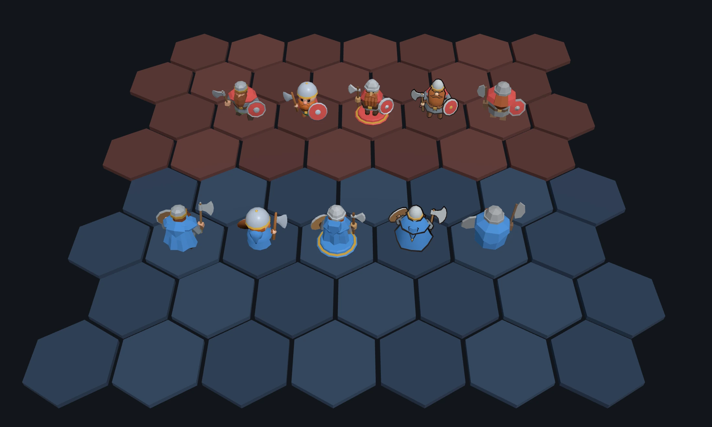

Left to right: A Faceted, B Chibi, C Carved, D Storybook, E Minimal.

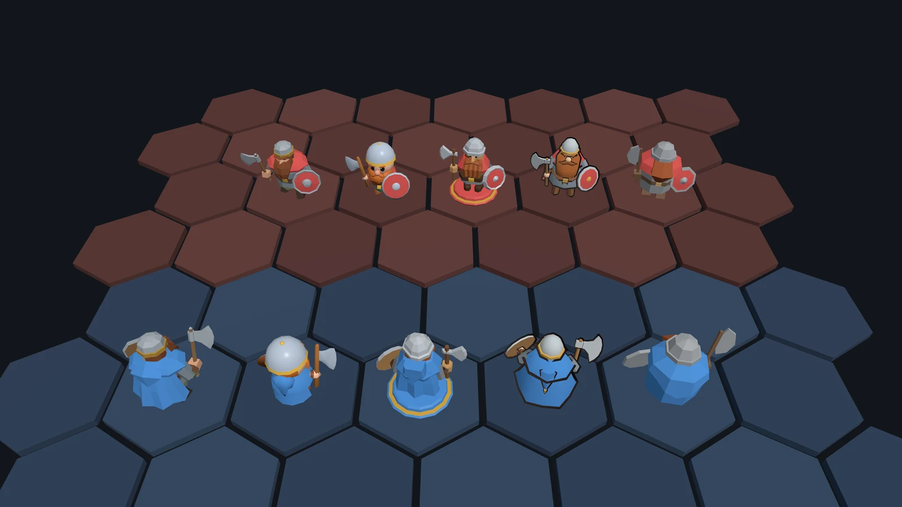

## A · Faceted (chosen)

Classic low-poly, done with care. Chunky octagonal forms are shaded flat, so every surface breaks into crisp facets that catch the light like chiselled stone. The proportions are grounded and heroic, and the palette is muted and earthy, so the team colour is the only saturated thing on him.

Triangles: 793 of 800 · Height: 1.15 · Shading: Flat · Materials: 12

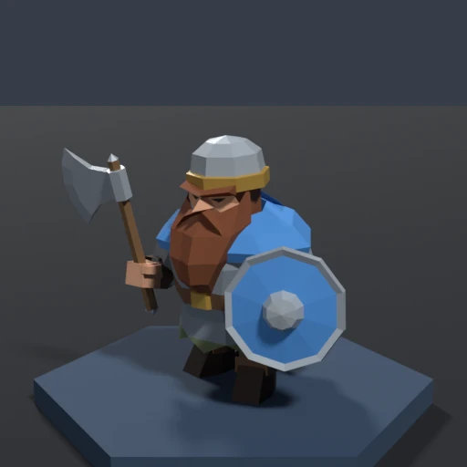 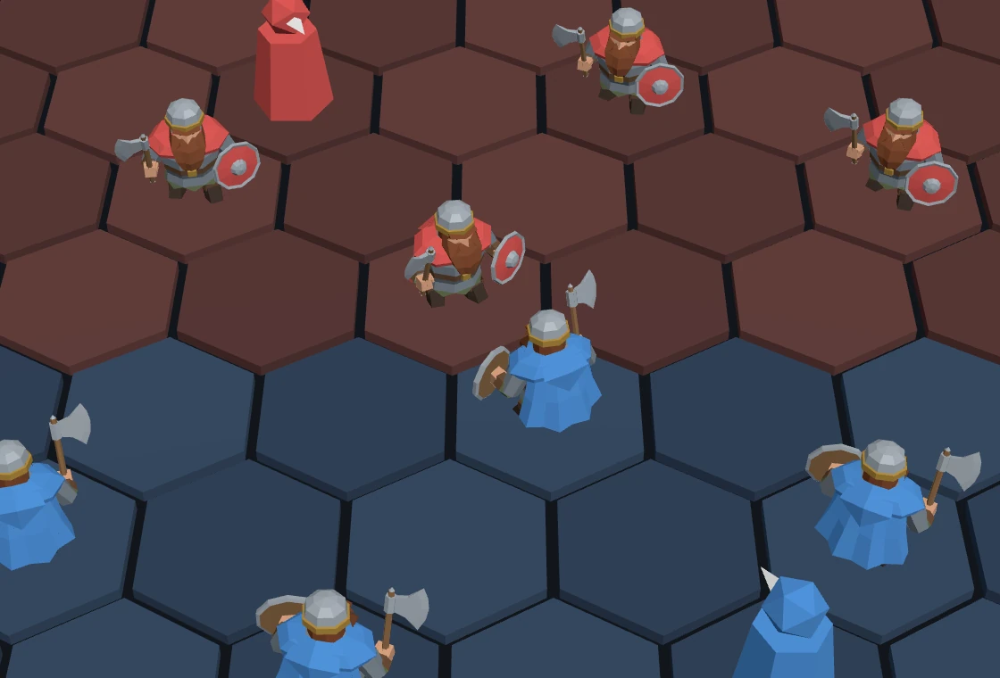

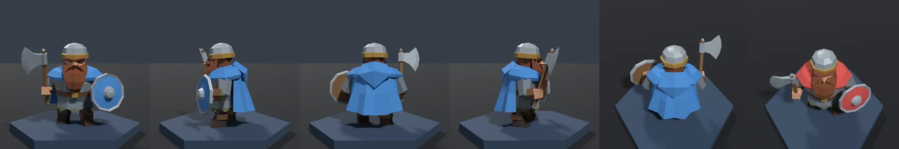

**Strengths**

- Reads as a dwarf Guardian at game size: a wide body, a light helmet, an axe over one shoulder and a shield on the other.
- Team colour is his biggest block from every side: the cape from behind, the mantle and shield from the front.
- The safe choice: it is the low-poly look the design document already names, and the client needs no changes.

**Weak spots**

- From behind, which is how you see your own units, the beard and face are hidden. He reads as a cape, a helmet and an axe.
- The face, buckle and mail hem vanish at game size, so units will be told apart by gear and colour.
- A shield and a weapon fill a Guardian's budget: he uses 793 of 800 triangles.

**Across the roster.** The most direct to scale. Octagonal torsos, tube limbs, helmets, cloaks, shields and blades become a shared kit, and each people's proportions become a table: short and round for Hobbits, tall and slim for Elves, hunched for Orcs. Nazgûl and Istari are straightforward; heroes of the same people, such as Merry and Pippin, need clearly different gear. About 1–2 hours a unit and 3–5 a monster once the kit exists.

## B · Chibi

A collectible vinyl toy. A huge helmeted head sits on a stubby body with an oversized axe and shield. The forms are soft and smooth-shaded, and the colours are bright with a slight sheen: a silver helmet with a brass band, an orange cloud of a beard, big glinting eyes, a rosy nose and blushing cheeks.

Triangles: 797 of 800 · Height: 1.11 · Shading: Smooth · Materials: 12

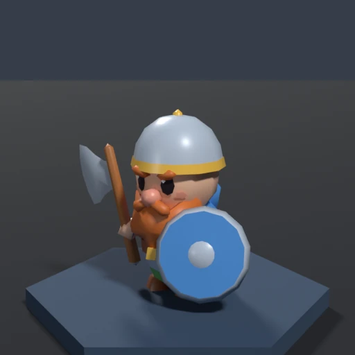 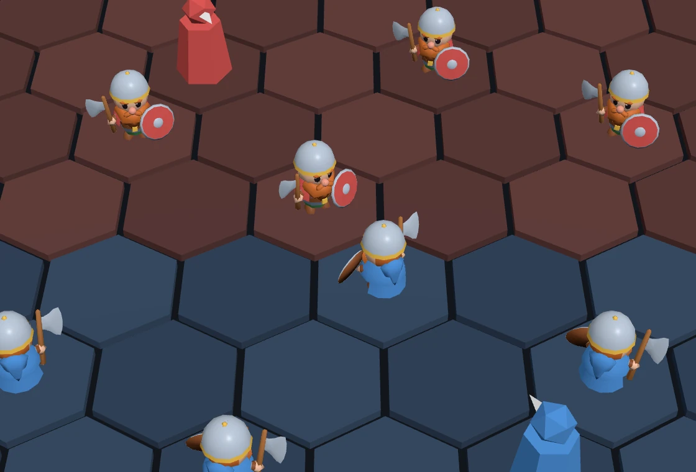

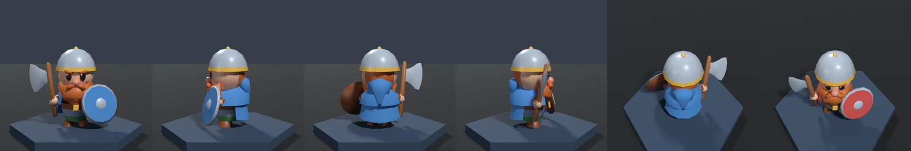

**Strengths**

- The friendliest and most expressive: from the front, the face still reads at game size, with dark eyes, a pink nose and an orange beard.
- The brass band rims every helmet, so units stand out against the dark board.
- Big shapes and big props make the role obvious: the shield is the largest thing on him.

**Weak spots**

- From behind, the big grey helmet is his loudest block, so your own units read as a grey dome over a blue cloak.
- Round forms eat triangles: one dwarf uses 797 of 800.
- A cute style has to work hard for menace. Orcs, Nazgûl, the Cave Troll and Sauron need angry brows, glowing eyes and spikes, and big heads flatten the height difference between Hobbits, Men and Elves.

**Across the roster.** Every humanoid reuses one kit: helmet and hood shapes, printed-on eyes, puffy beards and hair, mitt hands and capes. That's about an hour a unit and 2–3 hours a Large unit or monster. Each people needs its own head-to-body ratio and strong props, such as ears, hats and hair, so origins still read. The client needs no code changes, but the rule that models are shaded flat would go.

## C · Carved

An heirloom set of Middle-earth pieces. A chunky, knife-cut figure in satin paint stands on a turned plinth painted in the team colour and ringed with a gilt line. Bare wood shows where a carver would leave it: the face and hands, the axe haft and the back of the shield.

Triangles: 796 of 800 · Height: 1.20 with plinth · Shading: Flat · Materials: 11

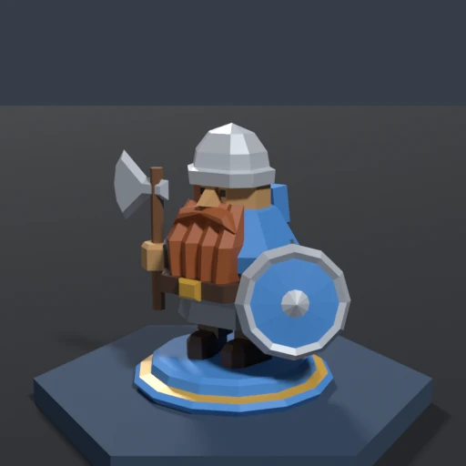 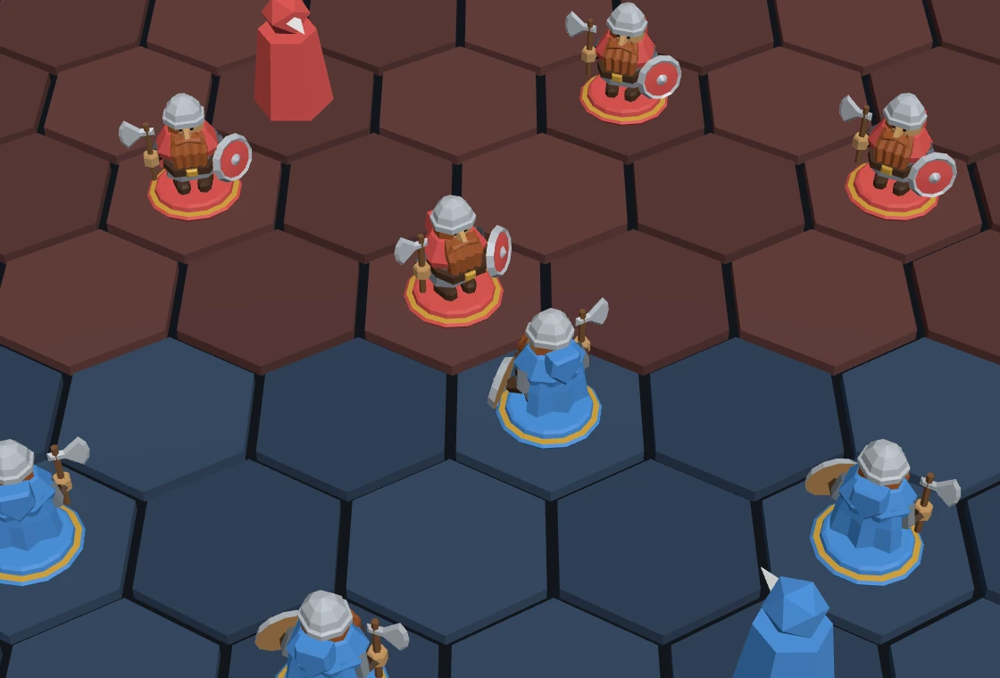

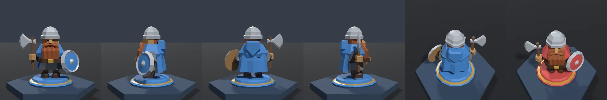

**Strengths**

- The clearest team colour of the five: a ring of colour round every base, readable from any angle and on the back rows.
- The plinth grounds each piece on the board, which matters because the game draws no shadows.
- A look of its own: the board becomes a tabletop and the units its pieces.

**Weak spots**

- The plinth costs 152 triangles and a tenth of the height, so the figure itself is the smallest of the five.
- From behind, the cape hides the beard, as with Faceted.
- The auburn beard sits close to the red team colour.

**Across the roster.** Nazgûl (a black hooded cone), Istari (robed like peg dolls), Hobbits and Treebeard (mostly bare wood) suit it best. Riders need a carved horse, probably on a Large budget, and bows must be carved thick. Monsters could stand on rough-hewn plinths and summons on small token discs, so you see what kind of piece each one is. About 2–3 hours a unit and 4–6 a monster. The board itself could become a wooden tabletop to finish the look.

## D · Storybook

A picture-book dwarf come to life. A bold sepia ink line runs round every shape, over flat, matte watercolour colours. The forms are simple and gently exaggerated: a tall helmet with a brass band, a big copper beard tucked into his belt, a potato nose under bushy brows, and a flaring hood and cape.

Triangles: 1,580 of 1,600 (800 + outline) · Height: 1.22 · Shading: Smooth, inked · Materials: 11

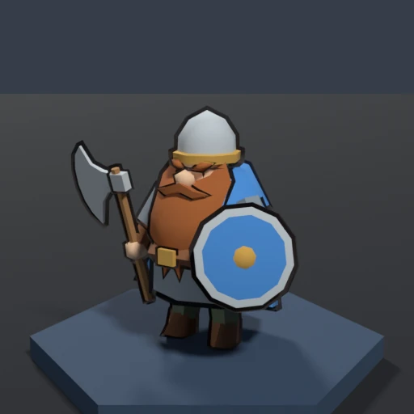 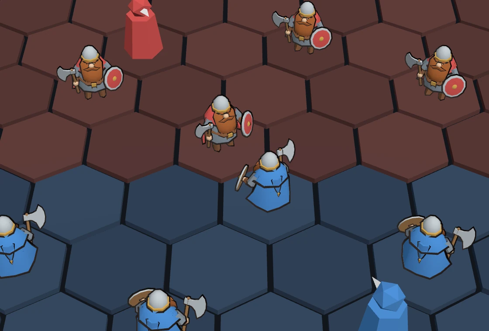

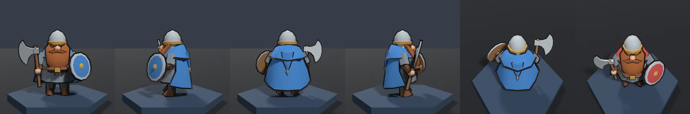

**Strengths**

- At game size the ink line is a crisp contour round every unit, so units stand off the board and apart from their neighbours, with no shadows to help.
- The most character up close: the face reads as nose, brows and moustache, and the whole figure looks hand-drawn.
- From behind, team colour is unmistakable: the mantle, cape and hood are almost all team colour.

**Weak spots**

- The outline doubles the triangles: 1,580 here, and about 4,000 for a Large unit.
- When a unit fades, the far side of its outline shows through its body. The client needs a fix, such as fading the outline faster.
- From the front the beard covers his chest, so the far team carries less team colour. Thin props such as bows and staffs need a minimum thickness, or the line swallows them.

**Across the roster.** Hoods, cloaks and beards are natural storybook shapes, and the helpers (lofts, tubes, revolves and an automatic outline in three line weights) carry over. Dark units such as Nazgûl, Orcs and Sauron need lifted colours so the ink still separates their parts, and Large units should be built at full size so the line weight stays even. About 2–3 render rounds a unit and double for a monster. The client can keep its materials or switch to toon shading.

## E · Minimal

A small abstract sculpture of 14 flat-shaded shapes and no face: a grey dome on a rust wedge of beard, team-coloured shoulders, a stout barrel body, a disc shield and a half-disc axe. The V of the beard in front is answered by the point of the hood behind. Calm, quiet and very cheap to draw.

Triangles: 288 of 350 · Height: 1.17 · Shading: Flat · Materials: 5

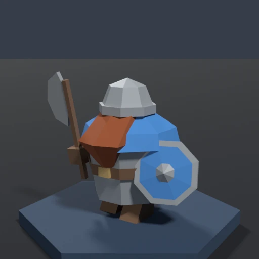 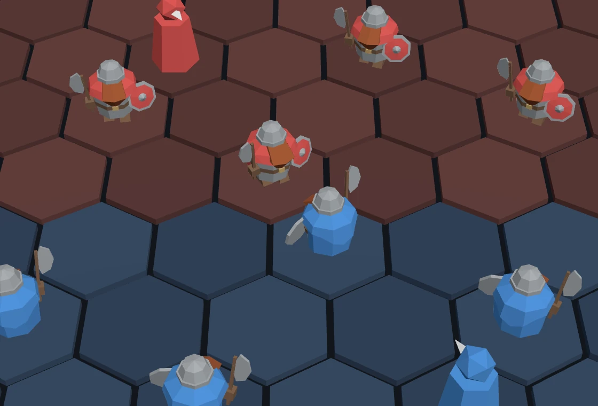

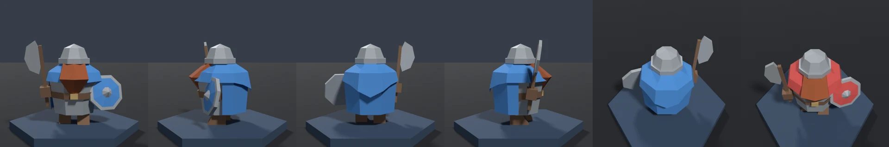

**Strengths**

- From the front it reads at once: a grey dome, a beard wedge, a shield and an axe.
- By far the cheapest to draw: 288 triangles and 5 materials.
- The calmest, most cohesive board of the five. Nothing is fiddly or noisy.

**Weak spots**

- From behind, your own units are a blue barrel under a grey dome: the weakest identity of the five.
- With no faces, 36 heroes need a roster-wide plan of signature shapes and colours. Four Hobbits or three Istari are hard to tell apart.
- Folds such as the hood's point fade under the game's flat lighting.

**Across the roster.** Each unit is a recipe of 8 to 15 shapes from a small kit: about 30–60 minutes a unit and 1–3 hours a monster. Nazgûl, hunched Orcs, Treebeard, Sauron and the Balrog (dark wedges with glowing orange) are natural fits. The work moves from modelling to design: a silhouette and colour sheet for the whole roster, so that no two units collide.

## Side by side

My read of each style against what the game needs, from best (three dots) to weakest (one).

| | A Faceted | B Chibi | C Carved | D Storybook | E Minimal |
|---|---|---|---|---|---|
| Reads at game size | ●●○ Clear from the front; a cape and helmet from behind. | ●●○ Faces read from the front; a grey dome from behind. | ●●○ Clear, but the smallest figure. | ●●● The ink line lifts every unit off the board, on both sides. | ●●○ Clear from the front; a blue barrel from behind. |
| Team at a glance | ●●● Mantle and shield in front, cape behind. | ●●○ Mostly the shield from the front. | ●●● A ring of colour round every base. | ●●○ Strong from behind; the beard covers the front. | ●●● Team colour is his biggest block. |
| Character up close | ●●○ Solid and detailed; the most familiar look. | ●●● Charming, with the most expressive face. | ●●● Charming; looks hand-made. | ●●● The most character; looks hand-drawn. | ●○○ Elegant, but impersonal by design. |
| Feels like Middle-earth | ●●● Grounded and heroic; dark units come easily. | ●○○ Cute; menace takes work. | ●●○ Warm and nostalgic; Nazgûl as black pieces. | ●●● Like a book illustration. | ●●○ Calm and atmospheric, but abstract. |
| Telling 36 heroes apart | ●●○ By gear and colour; faces are tiny. | ●●○ Faces help; heights flatten. | ●●○ By gear and paint; small figures. | ●●● Faces and silhouettes read best. | ●○○ Faceless; needs a roster-wide plan. |
| Cost to make and draw | ●●○ 800 triangles, 12 materials; 1–2 hours a unit. | ●●○ Round forms fill the budget; about an hour a unit. | ●●○ The plinth costs 150 triangles; 2–3 hours a unit. | ●○○ Twice the triangles and the most work a unit. | ●●● 288 triangles, 5 materials; under an hour a unit. |
| Changes to the client | ●●● None. | ●●● None in code; the flat-shading rule goes. | ●●● None; a wooden board would complete it. | ●○○ Fading units need a fix; toon shading is optional. | ●●● None. |

## Recommendation

I'd pick **D, Storybook**. An auto battler's board has to read at a glance, and its ink line outlines every unit at game size, on both sides, so units stand off the board and apart from their neighbours with no shadows to help. It also has the most character up close, and it looks like a book illustration rather than a film still, which suits a game drawn from the books.

Its costs are real: about twice the triangles (still light for a full board), a client fix for fading units, and more modelling per unit. If you'd rather keep the models cheap and the client untouched, **A, Faceted**, is the safe choice, and the ink line can be added to it later. **C, Carved**, is the boldest identity, if a board-game look appeals to you.

In every style, your own units show their backs, so the cape hides the beard, the strongest Dwarf cue. That comes from where the team colour sits, not from the style, and it's the first question below.

**Chosen on 30 October 2026: A, Faceted.**

### After choosing

1. Write the chosen style's rules into the viewer spec: proportions for each people, the palette, triangle budgets and where team colour goes.
2. Turn that style's helpers into a shared kit of bodies, heads, cloaks, shields and weapons, then model the 36 units, the monsters and the summons, with one command that rebuilds them all.
3. Load the models in the client, keep the pawn as a fallback, and check every unit in the game.

### Still to decide

- Where team colour lives: on cloaks and shields as here, or on a ring round the base, as Carved does. A ring frees each hero's clothes for their own colours, which helps tell 36 of them apart.
- How star levels show. The artists suggest trim that turns from brass to silver to gold, gilt lines on a plinth, or a tinted ink line.
- Whether Large units such as Treebeard and Sauron are built at full size in Blender instead of being scaled up by the client.
- Whether the board changes to match the style, such as a wooden tabletop for Carved.
